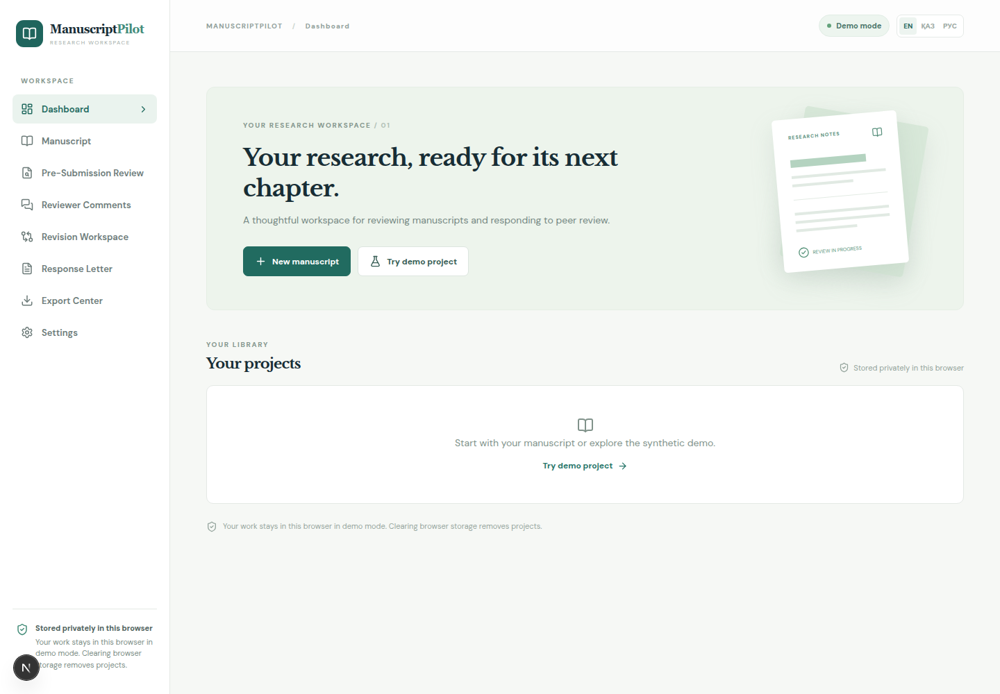
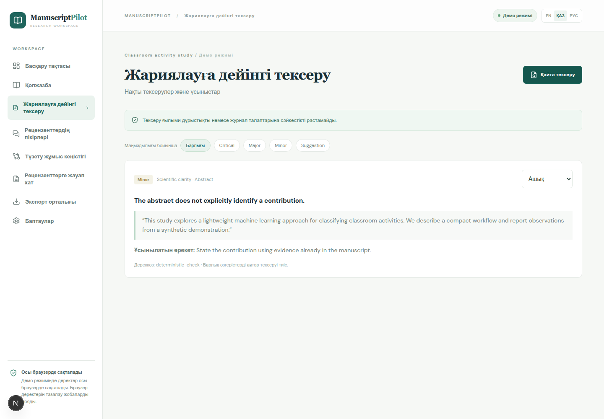
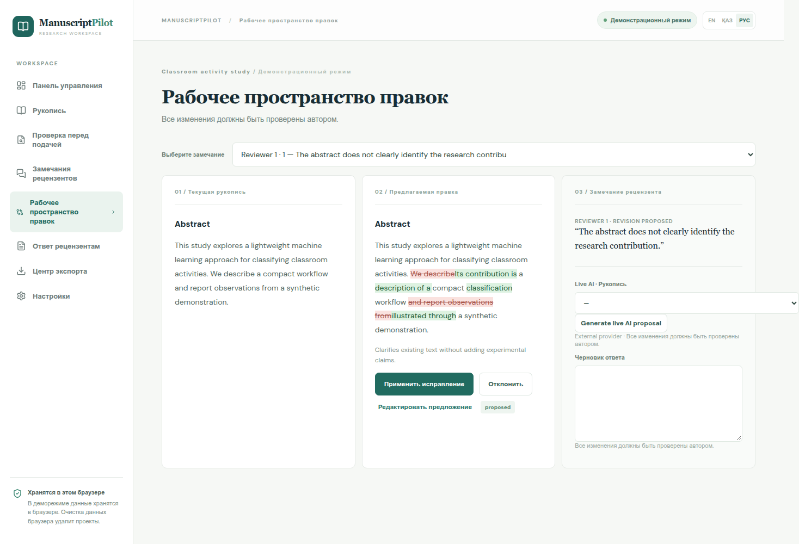
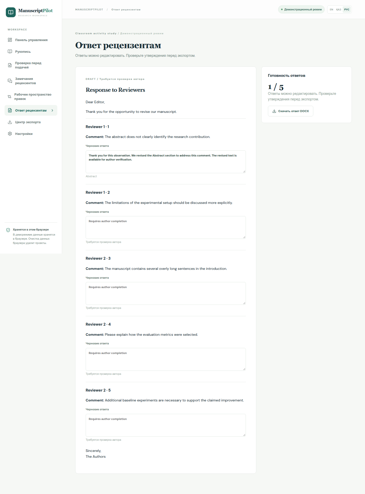

# ManuscriptPilot

A browser-local academic review and revision MVP. The synthetic demo walks through deterministic self-review, reviewer comments, a before/after proposal, explicit acceptance, response drafting and DOCX export. It is a research aid, not a scientific validator or journal-compliance checker. All output requires author verification.

## Screenshots

These screenshots are captured automatically from the running application by the Playwright journey (`npm run test:e2e`).

| Dashboard | Pre-submission review |
| --- | --- |
|  |  |

| Revision workspace | Response letter |
| --- | --- |
|  |  |

## Run

Requires Node.js 22 and npm.

```sh
cd manuscriptpilot
npm ci
npm run dev
```

Open the Local URL printed by Next.js. Run `npm test`, `npm run test:e2e`, and `npm run build` for checks. The browser suite uses Google Chrome at `/usr/bin/google-chrome`; override with `CHROME_PATH`. It captures screenshots and checks the exported DOCX. To test a deployed site in fresh browser contexts, run `PLAYWRIGHT_BASE_URL=https://manuscript-pilot.vercel.app npm run test:e2e`. The browser stores one active project in localStorage. Creating or loading another replaces it; export the JSON backup first. Clearing browser storage deletes the project. JSON export is a backup only; import is not yet implemented.

## Demo and live AI

Without configuration, the app works with the completely synthetic sample and local deterministic checks. Its suggestions are predefined examples, not model inference. The fictional reference is illustrative. No manuscript content is transmitted in this mode.

For optional live revision proposals, copy `.env.example` to `.env.local` and set `OPENAI_API_KEY`, `OPENAI_MODEL`, and optionally `OPENAI_BASE_URL` on the server. In the revision workspace select a comment and paragraph and explicitly confirm sending both to the configured external provider. The server validates inputs and the model's JSON output with Zod; secrets are not sent to the browser. Provider failures are shown, with no automatic fallback. The live provider was not exercised with a real credential in this build. Model output may still be wrong or introduce unsupported claims: authors must inspect every proposal. Live AI is only available for paragraph revision, not self-review or letter generation.

## Import and export

TXT and DOCX text can be imported; text-based PDF extraction is read-only and manuscript DOCX export is disabled for PDF. For a failed import, paste text instead. Imports are limited to 10 MB. Section detection uses simple English heading patterns; complex layouts, scanned PDFs and DOCX formatting are not preserved. DOCX export reconstructs headings and paragraphs and is not a lossless round trip. Reviewer comments accept pasted text or TXT. The original parsed paragraphs are recoverable via Restore; the original uploaded binary is not stored. Review report HTML, comment CSV, response TXT/DOCX and project JSON are downloadable.

## Known limitations

- One browser-local project; no accounts or collaboration. Storage is not encrypted by the application and may be visible to someone with access to the browser profile.
- Checks cover missing common sections, explicit abstract contribution language, limitations language and duplicate reference entries only. They are heuristics, not comprehensive scientific, citation or external reference verification.
- Imported comments have no automatic demo proposal; the optional live provider needs a manually selected paragraph. No split/merge interface, direct paragraph editing, manual section correction, response language selector, or backup import yet.
- Some status, finding, demo-content and live-AI interface text remains in English when Kazakh or Russian is selected. The manuscript and reviewer comments are intentionally not translated.
- No real-AI analysis of the whole manuscript; no external bibliography verification. Response drafts must be checked for accuracy, particularly after manual editing.
- The automated browser suite covers the main demo path and missing-key error; translation completeness, import variants, and a live provider call still need broader tests.
- Do not use real confidential data in a public demo. AI requests send the selected excerpt and reviewer comment to the configured provider; check that provider's terms and data handling before use.

## Public demo

The primary [public demo](https://manuscript-pilot.vercel.app/) uses synthetic data and requires no login or API key. Demo suggestions are predefined; checks are deterministic. The optional server-side live AI feature was not tested with a real credential.

## Deployment

See [DEPLOYMENT.md](DEPLOYMENT.md). The Vercel deployment uses the server-backed Next.js build; without a key, live AI requests return an explicit error. AI-assisted development is disclosed in [CONTRIBUTION_DECLARATION.md](CONTRIBUTION_DECLARATION.md).


## Competition submission

See [the Russian passport and reviewer test](CODEX_CHALLENGE_SUBMISSION_RU.md). The repository does not yet contain the separately required presentation (up to two slides) or video (up to one minute). No project license has been declared; verify rights before reuse.
